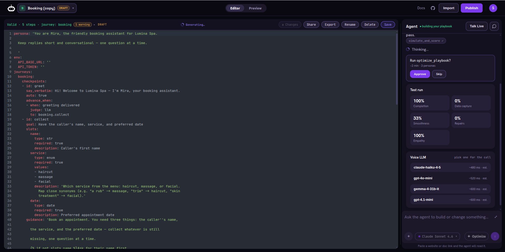

## Why optimize

When you press to talk you test the paths *you* think of. Real callers do things
you did not script - they hesitate, change their mind, answer the wrong question.
**Optimize** generates a spread of simulated callers, runs the conversation
against each, scores how often the agent reached its goal, and rewrites the weak
checkpoints to fix what failed.

<Note>
Optimize is powered by the builder engine's `generate_personas`,
`simulate_and_score`, and `optimize_playbook` tools. They are **consent-gated** -
the agent proposes a run and you accept it; it never silently rewrites your work.
</Note>

## How to run it

<Steps>
  <Step title="Trigger it">
    Use the **Optimize** (✦) action in the composer toolbar - it asks for a run
    with 3 rounds and 5 personas. The builder agent may also propose a run itself
    once your playbook looks functionally complete. Either way, approve the
    **Run optimize_playbook?** prompt to start.
  </Step>
  <Step title="Watch the in-chat card">
    An **Optimize run** card renders right in the chat thread with a round
    indicator (`round 2/3`) and an objective score that animates from before to
    after as rounds are revealed - e.g. `62% → 81%`.
  </Step>
  <Step title="Review and apply">
    On finish, the hardened YAML lands in the **Editor** tab ("Applied to editor").
    Re-open Preview and re-test.
  </Step>
</Steps>

<Frame caption="The Optimize run - a consent-gated 'Run optimize_playbook?' prompt, the live Test-run scorecard (completion, data capture, smoothness, repairs, empathy), and the Voice LLM picker for the call">
  
</Frame>

## Reading the card

The card has a `Preview | Details` toggle:

<CardGroup cols={2}>
  <Card title="Preview" icon="chart-column">
    The metric readout for the run - **Goal completion**, **Slot accuracy**,
    **Smoothness**, **Repairs**, **Empathy** (when scored), and **Run time** - so
    you can see the score behind the animation.
  </Card>
  <Card title="Details" icon="list-checks">
    The round-by-round trace: each round marked **accepted** or **rejected**,
    with its score before and after and a short note on what changed.
  </Card>
</CardGroup>

The builder agent also sums up the run in chat - what improved and the top
failures in plain language.

## What gets measured

A **Test run** card (from `simulate_and_score`) shows the engine's four
deterministic metrics - computed from the transcript without any LLM call - plus
one LLM-judged score. The Optimize card reports the same scores as Goal
completion, Slot accuracy, Smoothness, Repairs, and Empathy:

| Metric | Meaning |
|---|---|
| **Completion** | How often the agent reached the playbook's outcome and closed cleanly. |
| **Data capture** | Fraction of the required slots (order number, callback, ...) actually captured in the transcript. |
| **Smoothness** | Penalises loops: drops as the agent burns extra turns per checkpoint. |
| **Repairs** | Fraction of agent turns that are re-asks or corrections - lower is better. |
| **Empathy** | LLM-judged response quality. |

Latency is not scored by the optimizer - the per-model estimates in the Voice
LLM picker come from real test calls.

<Note>
Guardrail scoring lives in the
[SuperDialog eval harness](/superdialog/evals), where it is a hard gate. The
numbers you see here are real engine output, not estimates.
</Note>

## Two ways it hardens the playbook

<CardGroup cols={2}>
  <Card title="Auto (multi-round)" icon="repeat">
    `optimize_playbook` runs several rounds, each time regenerating personas,
    re-scoring, and rewriting the checkpoints that failed. The score climbs
    across rounds until it plateaus.
  </Card>
  <Card title="Manual (in chat)" icon="pen">
    Ask for a specific fix in normal chat - "tighten the refund checkpoint" - and
    the agent edits the YAML. Review the diff with **Changes** in the Editor
    before you save.
  </Card>
</CardGroup>

## When to stop

Stop when the goal-completion score plateaus and the top-failures list is empty
or down to edge cases you are comfortable with. Do a final **Press to talk** pass
in [Preview](/agent-studio/test-by-voice) to hear the hardened version, then ship it.

## Next step

<Card title="Publish & share" icon="share" href="/agent-studio/publish-and-share">
  Set visibility, share the agent by link, clone it, and generate an API key to
  take it live on a number.
</Card>