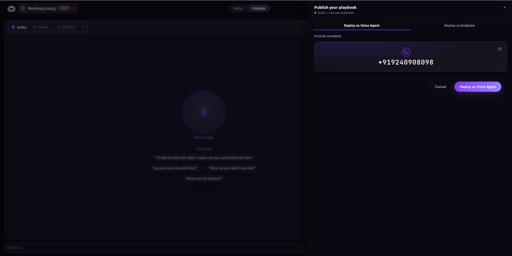
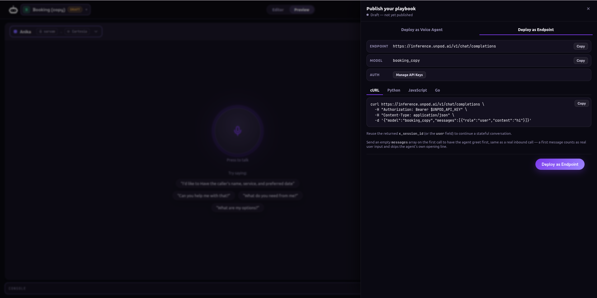

## Save vs. publish

**Saving** (from [Build an agent playbook](/agent-studio/build-an-agent)) keeps a playbook
private to you as a draft. **Publishing** is the deliberate step that deploys it -
either **as a voice agent on a phone number** or **as an API endpoint** - and
unlocks sharing and export. Until you publish, the deploy drawer header shows
`Draft — not yet published` and the playbook picker tags it **Draft**.
Publishing needs an account - guests do not see the **Publish** button.

<Note>
This page starts after you have a working, saved playbook. If you have not saved
yet - or want to move a playbook in or out as a file - see
[Save, import & export](/agent-studio/build-an-agent#step-4-save-import-export) on the Build page.
</Note>

<Warning>
Visibility changes who can see and run your agent. Read the levels below before
you share - "Public" lists the agent in a gallery anyone can find.
</Warning>

## Step 1 - Set visibility

Once the playbook is published (see [Step 4 - Deploy](#step-4-deploy)), open
**Share** in the Editor pane's toolbar (owner only). Pick one of three visibility levels:

| Visibility | Who can reach it |
|---|---|
| **Private** | Only you (the default). |
| **Link only** | Anyone with the link can open it - not discoverable otherwise. |
| **Public** | Listed in the public gallery for anyone to find and test. |

You can change visibility at any time; the setting is saved server-side. A
**Link** or **Public** badge marks a shared playbook; private ones carry no badge.

## Step 2 - Share by link

For a **Link only** or **Public** playbook, the Share popover shows the link -
use **Copy**. Someone who opens it signs in (or signs up) and lands in the
Playground with your agent loaded, where they can talk to it.

<Card title="Rotate a leaked link" icon="rotate-ccw">
  If a link gets out, use **Rotate** in the Share popover to revoke the old
  link and issue a new one.
</Card>

<Note>
Shared access is **view + run**. Someone opening your link can test the agent
and clone it; they cannot edit your original.
</Note>

## Step 3 - Let others build on it (clone)

Anyone viewing a shared or public playbook can use **Duplicate to edit** in the
Editor, then **Clone & edit**, to save their own private copy to **My
Playbooks**. It is the fastest way to hand a teammate a working starting point -
they clone, tweak, and publish their own version without touching yours.

## Step 4 - Deploy

**Publish** in the top bar opens the **deploy drawer** ("Publish your
playbook"), which offers **two ways to ship** the same agent. Pick the one that
matches how callers will reach it:

<CardGroup cols={2}>
  <Card title="Deploy as Voice Agent" icon="phone">
    Put it on a **real phone number**. Choose a number and the drawer wires up a
    speech pipe for you - inbound callers reach the agent immediately.
  </Card>
  <Card title="Deploy as Endpoint" icon="code">
    Turn it into a **callable API** with an API key, so your own backend drives
    the agent. No phone number involved.
  </Card>
</CardGroup>

Both run the **same published playbook and the same `AgentRunner`** you tested in
Preview - nothing is re-implemented on the way to production.

### Deploy as Voice Agent

<Frame caption="Deploy as Voice Agent - pick a number from the picker, then deploy">
  
</Frame>

<Steps>
  <Step title="Pick a number">
    The drawer loads your available numbers under **Phone number** - use **Show
    another number** to cycle through them.
  </Step>
  <Step title="Confirm">
    On deploy the platform assigns the number and provisions a **speech pipe**
    behind it - you get a "Deployed!" confirmation with the wired pipe.
  </Step>
  <Step title="Call it">
    Dial the number, or dispatch an outbound call to it. The agent answers with
    the playbook you tested.
  </Step>
</Steps>

<Note>
Need a number first, or want to manage pipes by hand? See
[Numbers](/speech-stack/numbers) and [Speech Pipes](/agent-sdk/pipes) - the
Voice Agent deploy is the one-click version of that wiring.
</Note>

### Deploy as Endpoint

Turns the agent into an **OpenAI-compatible** `chat/completions` API. The drawer
shows your **Endpoint**, the **Model** (your playbook id), and a ready-to-run
snippet in cURL, Python, JavaScript, Go, LiveKit, and Pipecat.

<Frame caption="Deploy as Endpoint - endpoint, model id, Manage API Keys, and per-language snippets">
  
</Frame>

<Steps>
  <Step title="Deploy & create a key">
    Hit **Deploy as Endpoint**, then **Manage API Keys** (it opens **Settings →
    Security → API keys** in the Playground) to mint one. Copy it now - it is
    shown once; treat it like a password. Regenerate it any time if it leaks.
  </Step>
  <Step title="Copy the snippet">
    Pick your language tab. Each snippet is pre-filled with your endpoint, your
    `model` id, and an `Authorization: Bearer $UNPOD_API_KEY` header. That is the
    same variable name the Python SDK reads for its own credential, so the
    examples on these pages use `UNPOD_ENDPOINT_KEY` instead - rename it in the
    snippet if both live in one environment.
  </Step>
  <Step title="Call it from your app">
    Point any OpenAI SDK at the base URL. The agent runs the exact playbook you
    tested in Preview.
  </Step>
</Steps>

```bash Example
curl https://inference.unpod.ai/v1/chat/completions \
  -H "Authorization: Bearer $UNPOD_ENDPOINT_KEY" \
  -H "Content-Type: application/json" \
  -d '{"model":"PB_7ZRMzCA1ojQ9LlcK","messages":[{"role":"user","content":"hi"}]}'
```

<Warning>
API keys carry your account's access. Store them in a secret manager or
environment variable (`UNPOD_ENDPOINT_KEY` in these examples - not `UNPOD_API_KEY`,
which the Python SDK reads for a different credential), never in client-side code or a committed
file. Revoke and regenerate immediately if one is exposed.
</Warning>

<Card title="Full Chat API reference" icon="terminal" href="/agent-studio/api">
  Headers, request body, stateful sessions via `user`, and cURL / Python /
  JavaScript / Go examples.
</Card>

## Bring your own key (BYOK)

If you want calls billed to **your** provider account instead of the Playground
wallet, click **BYOK** in the Preview header, paste keys for any of OpenAI,
Deepgram, Cartesia, ElevenLabs, Soniox, or Sarvam, and hit **Use my keys**.
Sessions then run on your keys; **Use platform keys instead** reverts to the
shared wallet. Keys are sent to the server for the session only, never stored
in your browser.

<Note>
Guest and trial usage draws on a metered wallet - you will see a balance chip and
an "out of minutes" prompt when it runs low. BYOK sidesteps that by using your
own provider quota.
</Note>

