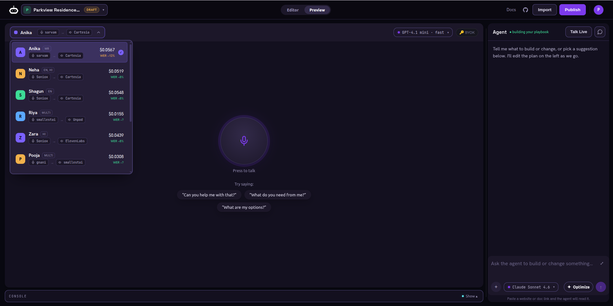
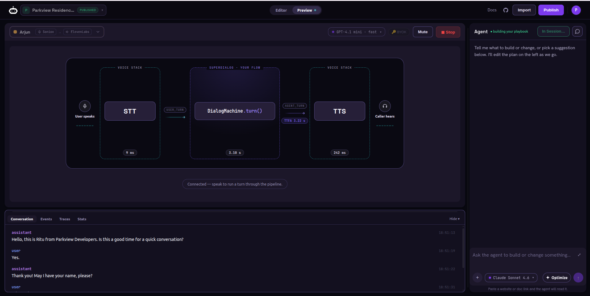

## Preview is the test

There is no separate "test mode" and no phone number needed. The **Preview** tab
runs a live voice session against your current playbook using the same
`AgentRunner` that serves a production call. What you hear here is what a caller
hears.

<Note>
Your microphone streams up at 16 kHz; the agent's synthesized voice streams back
at 24 kHz. The audio rides a WebSocket bridge; the transcript and checkpoint
arrive on a **separate** side channel, so the transcript stays accurate even when
audio is under load.
</Note>

## Step 1 - Set the voice and model

The Preview header shows the current voice (its name and **STT → TTS** route).
Click it, or **Agent Settings**, to open the settings drawer:

<CardGroup cols={2}>
  <Card title="Voice profile" icon="audio-lines">
    Pick the voice the agent speaks in - the same voice a real caller would hear.
    Each profile shows its **language**, its **STT + TTS providers**, a **price**,
    and an estimated **WER** (word-error-rate) quality hint.
  </Card>
  <Card title="LLM" icon="cpu">
    Choose the model the **agent** runs on (separate from the builder model in
    the chat). The picker shows speed hints like `GPT-4.1 mini · fast`. The
    **BYOK** button in the Preview header lets you run on your own provider keys.
  </Card>
</CardGroup>

The same drawer also has **Transcriber** and **Voice** overrides and a
**Config** section for memory and the domain dictionary.

<Frame caption="Voice profile picker - language, STT/TTS stack, cost per turn, and WER for each voice">
  
</Frame>

<Tip>
If **Press to talk** is disabled, the button itself tells you why - usually a
missing voice profile or an unsaved playbook. Pick a voice and save, and the
control unlocks.
</Tip>

## Step 2 - Press to talk

The center of the Preview is a single **Press to talk** control.

<Steps>
  <Step title="Idle">
    You see the orb plus a row of **"Try saying:"** opener chips - example first
    lines pulled from your playbook. They are prompts for *you*; they are not
    injected into the agent.
  </Step>
  <Step title="Connect and speak">
    Press it, allow the mic, and talk as a caller would. The session connects and
    the agent answers in the voice you chose.
  </Step>
  <Step title="Live">
    A pipeline readout (STT → your flow → TTS) shows the current stage and the
    checkpoint the conversation is in. **Mute** and **Stop** sit in the Preview
    header while the session runs.
  </Step>
</Steps>

<Frame caption="Connected - each turn runs through the same STT -> DialogMachine.turn() -> TTS pipeline a live caller hits">
  
</Frame>

## Step 3 - Read the live signal

While you talk, three things tell you whether the playbook works. Open the
console with **Show** in the Preview header to see the transcript and metrics:

| Surface | What it tells you |
|---|---|
| **Transcript** (console **Conversation** tab) | The exact turns, with timestamps, so you can see where the agent misread you. |
| **Current checkpoint** (pipeline readout) | Which checkpoint the conversation is in, and whether it advanced when it should have. |
| **Metrics** (console **Stats** tab) | TTFA (time to first audio), STT p95, TTS p95, turn count, and cost so far. |

### What to actually check

- The **persona and voice** sound right to a caller.
- Checkpoints **advance on the conditions you wrote** (`done_when` /
  `advance_when`) - not too early, not too late.
- **Slot collection** works: the agent captures what it needs (order number,
  callback) before moving on.
- **Interrupts** fire from any step - saying "goodbye" or "I'm busy" ends the
  call gracefully.

## Step 4 - Dig in when something is off

Open the **console** below the call (**Show** in the Preview header). Its tabs
are **Conversation**, **Events**, **Traces** (per-turn LLM calls and timings),
**Stats**, **Traversal**, and **Memory**. Use it to see *why* a checkpoint did
not advance - the Director's judgment and any tool calls are all there.

<Warning>
The console shows the engine's own events and never leaks raw provider errors.
If a turn fails, you get a clean surface here, not a stack trace.
</Warning>

## The tight loop

Testing is meant to feed straight back into authoring - both panes stay mounted,
so a turn in flight survives a tab switch:

<Steps>
  <Step title="Hear a problem in Preview">
    e.g. the agent offers 5pm before the caller declines 4pm.
  </Step>
  <Step title="Fix it in chat or the Editor">
    "Only offer 5pm after the caller says 4pm doesn't work." The YAML updates.
  </Step>
  <Step title="Press to talk again">
    Re-test the same path. Repeat until it behaves.
  </Step>
</Steps>

## Next step

When it behaves on the paths you tried by hand, let the optimizer stress it
against many simulated callers.

<Card title="Optimize the playbook" icon="gauge" href="/agent-studio/optimize">
  Run generated personas, score goal completion, and harden the weak spots
  automatically.
</Card>