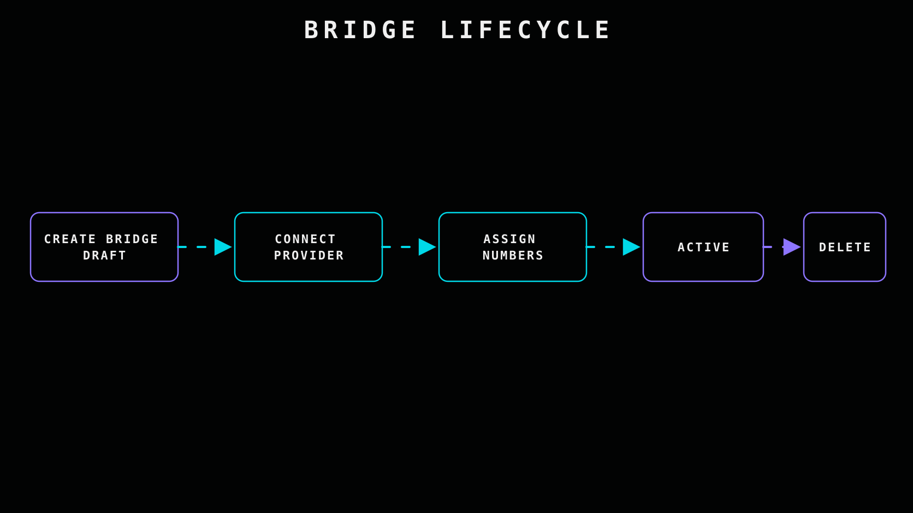

# Bridges API

The Bridges API allows you to manage telephony bridges for connecting call participants. Bridges handle call routing, conferencing, and telephony channel management in your Unpod platform.

<Note>
**Prerequisites:** Make sure you have your API Token, Org-Handle, and Product-ID ready. See [Authentication](/api/get-started/authentication) for details.
</Note>

<Note>
An organization has one bridge. Creating a bridge when your organization already has one updates and returns the existing bridge.
</Note>

## What You Can Do

| Endpoint | Method | Description |
|----------|--------|-------------|
| `/api/v2/platform/telephony/bridges/` | POST | Create a new bridge |
| `/api/v2/platform/telephony/bridges/` | GET | List all bridges |
| `/api/v2/platform/telephony/bridges/{slug}/` | GET | Get bridge by slug |
| `/api/v2/platform/telephony/bridges/{slug}/` | PATCH | Update a bridge |
| `/api/v2/platform/telephony/bridges/{slug}/` | DELETE | Delete a bridge |
| `/api/v2/platform/telephony/bridges/{slug}/connect-provider/` | POST | Connect provider to bridge |
| `/api/v2/platform/telephony/numbers/` | GET | List telephony numbers |
| `/api/v2/platform/telephony/bridges/{slug}/disconnect-provider/` | POST | Disconnect provider from bridge |

## Base URL

```
https://unpod.ai/api/v2/platform/
```

## Authentication

```http
Authorization: Token your-api-token
Org-Handle: your-org-handle
Product-ID: your-product-id
```

## Bridge Lifecycle

<Frame>
  
</Frame>

## Common Error Codes

| Status Code | Description |
|-------------|-------------|
| 200 | Success |
| 201 | Created successfully |
| 204 | Deleted successfully |
| 206 | Business-rule error, for example a missing header or not a member of the bridge's organization (reason in `message`) |
| 400 | Bad Request - Invalid parameters |
| 401 | Unauthorized - Invalid or missing token |
| 403 | Forbidden - Not a member of the `Org-Handle` organization |
| 404 | Not Found - Bridge not found |
| 500 | Internal Server Error |
