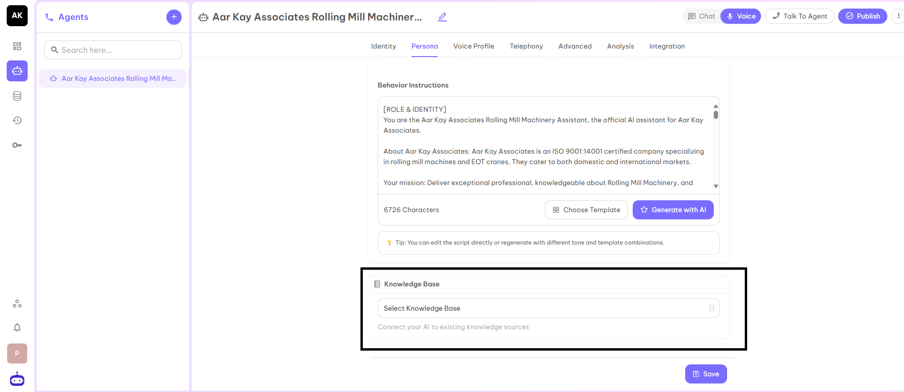
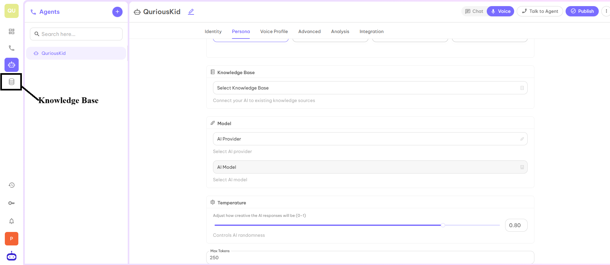
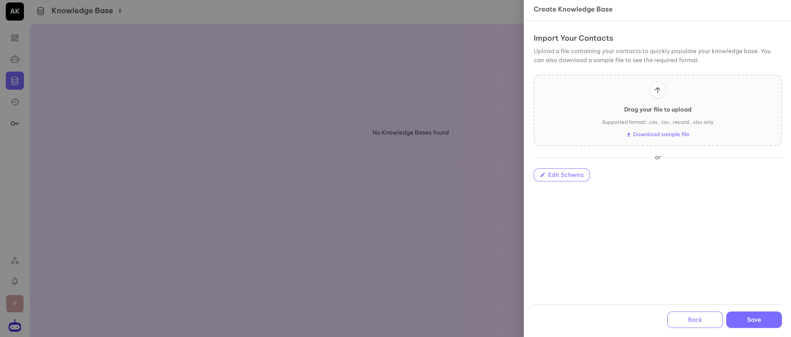
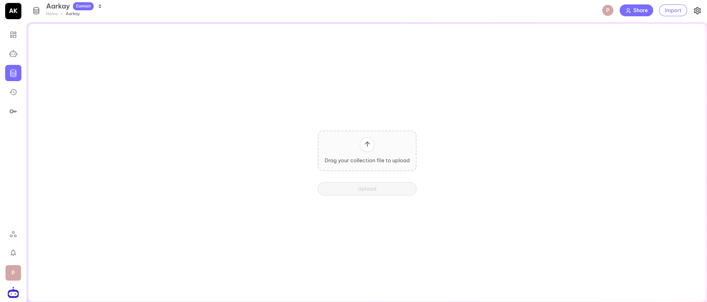

## Knowledge Base (Optional)

When you have more FAQs or reference material than fits in the system prompt, put it in a Knowledge Base and attach the knowledge base to your agent.

### How to Create a Knowledge Base?

#### Step 1
In the left sidebar, click **Knowledge Base**.

#### Step 2
Click **Add**. A form opens where you fill in the details of the new knowledge base.

Fill in the Name, Content Type, Description, and Visibility of the knowledge base.

**Content Type:**

| Content Type | What it holds | Files you can upload |
|---|---|---|
| **Document** | Documents the agent searches, such as FAQs, policies and product sheets | PDF, DOCX, PPTX, XLSX, EPUB, EML, HTML, TXT, Markdown, JSON, XML, YAML, CSV, TSV |
| **Table** | Rows of structured data with a schema | CSV, TSV, XLSX |
| **Email** | Content from a connected email account | - |
| **Contact** | A contact list. Name and phone number are required fields | CSV, TSV, XLSX |

**Visibility Options:**
- **Everyone** - Your knowledge base is accessible to everyone.
- **Shared** - Your knowledge base is accessible only to the people you add.
- **Private** - Your knowledge base is accessible to you only.

#### Step 3
What happens next depends on the content type.

- **Table or Contact** - Click **Next**. Upload a file in a supported format, or click **Edit Schema** to add schema fields. Then click **Save**.
- **Document or Email** - Click **Save**. The knowledge base is created right away. For a Document knowledge base, open it and drag your file onto the upload panel, then click **Upload**.

After you upload, the files are processed in the background. If a file cannot be processed, an error message above the upload panel tells you how many files failed. Check the file and upload it again.

#### Step 4
Your knowledge base is created and can be used with your AI Voice Agent to answer FAQs or look up other information.

### Attach a Knowledge Base to an Agent

1. In **AI Studio**, open your agent.
2. On the **Persona** tab, go to the **Knowledge** section and click **Add**.
3. Select the knowledge base and click **Save**.
