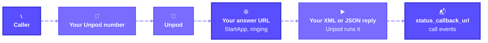

When someone calls your number, Unpod hands the call to your own app or an Unpod AI agent,
whether it reached Unpod on an Unpod number or through your carrier's trunk. For your app,
Unpod asks your answer URL what to do while the call is still ringing, then runs the XML or
JSON you reply with.



## Three ways to answer

| Your number | Answered by | Set up with |
| --- | --- | --- |
| Unpod number | Your app | The number's answer URL ([below](#point-your-number-at-your-app)) |
| Unpod number | An Unpod AI agent | [`numbers.attach(number, agent_id=…)`](/telephony/apis/numbers) - no code to host |
| Your carrier's number | Your app or an agent | [SIP Trunking](/telephony/quickstart), then the trunk's inbound config ([below](#for-a-whole-sip-trunk)) |

For your app to answer, attach the number with `attach_type="human_call"` (see the
[Quick Start](/telephony/apis/quickstart#make-your-first-call)). On a number attached to an
AI agent, the agent always answers: your answer URL can only reject the call (a reply that
starts with `<Hangup/>`), and no `Hangup` event reaches the answer URL.

{/* TODO(verify): agent-attached numbers take the external-bridge route */}

## Point your number at your app

**Dashboard:** open the number in the [Unpod dashboard](https://unpod.ai/) and set its
answer URL.

{/* TODO(verify): dashboard path to set a number's answer URL */}

**API:**

<CodeGroup>
```python Python
from unpod import Client
from unpod.telephony import InboundConfig

NUMBER = "+919000000001"  # your Unpod number
URL = "https://your-app.example.com/incoming"

with Client() as client:
    inbound = client.telephony.inbound
    inbound.set_did(NUMBER, InboundConfig(
        answer_url=URL,
        answer_method="POST",
        status_callback_url=URL,
    ))
    print(inbound.get_did(NUMBER))  # the config in effect
```

```bash cURL
# set
curl -s -X PUT "https://unpod.ai/api/v2/platform/sbc/v1/dids/%2B919000000001/inbound" \
  -H "Authorization: Token $UNPOD_PLATFORM_TOKEN" -H "Org-Handle: $UNPOD_ORG_HANDLE" \
  -H "Content-Type: application/json" \
  -d '{"answer_url": "https://your-app.example.com/incoming", "answer_method": "POST",
       "status_callback_url": "https://your-app.example.com/incoming"}'

# read the config in effect
curl -s "https://unpod.ai/api/v2/platform/sbc/v1/dids/%2B919000000001/inbound" \
  -H "Authorization: Token $UNPOD_PLATFORM_TOKEN" -H "Org-Handle: $UNPOD_ORG_HANDLE"
```
</CodeGroup>

`set_did` sets the config for one number. In the URL, `+` becomes `%2B`. A `PUT` replaces
the number's own config; fields you leave out come from its
[trunk](#for-a-whole-sip-trunk). `get_did` returns the config in effect. The number must be
one of your org's numbers, otherwise `404`.

<Info>
Inbound configuration is rolling out and needs the Call API switched on for your org (see
the [Quick Start](/telephony/apis/quickstart)). If `set_did` (or the `PUT`) returns `403`
(Call API not switched on), `405` or `401`, ask the Unpod team to switch it on or set the
answer URL on your number for now.
</Info>

### `InboundConfig` fields

| Field | Meaning |
| --- | --- |
| `answer_url` / `answer_method` | Where Unpod sends new inbound calls. `POST` (default) or `GET` |
| `answer_timeout_ms` | 500-10000 (default 3000). How long Unpod waits for your reply |
| `answer_fallback` | `static_routing` (default) or `reject_503` when your app does not answer. See [below](#when-your-server-is-down) |
| `status_callback_url` / `_format` | Where call events go, as `form` (default) or `json` |
| `status_callback_method` | `POST` only: inbound call events are always POSTed |
| `recording_callback_url` | Where the recording event goes |
| `record` | Stored, not applied yet |
| `tts_voice`, `tts_language` | Defaults for the [speak](/telephony/apis/call-control#play-audio-and-speak) endpoint on this number's calls. XML `<Speak>` uses only its own `voice` and `language` |

## The webhook secret

Your org has one signing key for every request Unpod sends you: inbound answer-URL requests
and status callbacks alike. Create it with `webhook_secret.rotate()` (org owner or admin).
The full secret is shown only in that response, so store it as `UNPOD_WEBHOOK_SECRET`.

<CodeGroup>
```python Python
from unpod import Client

with Client() as client:
    s = client.telephony.webhook_secret.rotate()
    print(s.pushed_to_sbc)  # must be True
    print(s.secret)         # shown in full only here
```

```bash cURL
curl -s -X POST "https://unpod.ai/api/v2/platform/sbc/webhook-secret/rotate" \
  -H "Authorization: Token $UNPOD_PLATFORM_TOKEN" -H "Org-Handle: $UNPOD_ORG_HANDLE" \
  -H "Content-Type: application/json" -d '{}'
```
</CodeGroup>

<Warning>
Rotating creates a new key and invalidates the old one. A server still verifying with the
old key rejects every request with 401 until you give it the new one, and on inbound calls
that 401 makes Unpod apply the [fallback](#when-your-server-is-down).
</Warning>

Unpod signs inbound POST requests once your org has a secret, so create it before you point a
number at a server that verifies. GET requests are not signed. Verify each request with
`parse_call_event`, as in the server below. See [Webhooks](/telephony/apis/webhooks) for the
signature format and every event field.

## Handle the call

Unpod sends your answer URL three events of its own. Reply to `StartApp` with instructions
(see [Answer URL & XML](/telephony/apis/answer-url) for every verb) and return 200 for the
rest.

| `ev.event` | What to do |
| --- | --- |
| `StartApp` | A new call, still ringing (`ev.call_status` is `ringing`). Reply with XML. Reply `<Hangup/>` first to reject it (`reason="busy"` sends 486, anything else 603), or `<Speak>…</Speak><Hangup/>` to tell the caller you're busy |
| `Hangup` | The call ended. Log `ev.duration` and `ev.call_status`: `completed`, `busy`, `no-answer`, `failed` or `cancel` |
| `RecordStop` | A `<Record>` from your reply reached its `maxLength`. After the call, get the audio with `get_recording(ev.call_id)` ([Recording](/telephony/apis/recording)) |

Point `status_callback_url` at the same route, as in the config above. Unpod sends the
answer URL's `Hangup` only once, but retries a status callback a few times over about 30
seconds ([Delivery and retries](/telephony/apis/webhooks#delivery-and-retries)), so a
missed `Hangup` usually arrives again. The route then also receives call events, such as
`Incoming`, `Ringing`, `Answered` and a `Hangup` per leg: return 200 for them. `Hangup` can
arrive more than once, which `on_call.pop(ev.call_id, None)` below handles. Every event
for a call carries the same `ev.call_id`; `ev.leg_id` differs per leg.

This server routes each caller to a free agent's phone, or tells them everyone is busy:

```python app.py
import os

import uvicorn
from fastapi import FastAPI, HTTPException, Request, Response
from unpod.telephony import WebhookSignatureError, parse_call_event

SECRET = os.environ["UNPOD_WEBHOOK_SECRET"]
AGENTS = ["+919000000003", "+919000000005"]  # your agents' phones
# call_id -> agent. In memory: run one process (no --workers or replicas)
# or keep it in shared storage.
on_call: dict[str, str] = {}
app = FastAPI()


def xml(verbs: str) -> Response:
    return Response(f"<Response>{verbs}</Response>", media_type="application/xml")


@app.post("/incoming")
async def incoming(request: Request):
    try:
        ev = parse_call_event(await request.body(), request.headers, secret=SECRET)
    except WebhookSignatureError:
        raise HTTPException(401)

    if ev.event == "StartApp":  # a new call is ringing
        free = next((a for a in AGENTS if a not in on_call.values()), None)
        if free is None:
            return xml("<Speak>All our agents are busy.</Speak><Hangup/>")
        on_call[ev.call_id] = free
        return xml(f"<Dial><Number>{free}</Number></Dial>")

    if ev.event == "Hangup":
        on_call.pop(ev.call_id, None)  # the agent is free again; safe to repeat
        print(ev.call_id, ev.call_status, ev.duration)
    elif ev.event == "RecordStop":
        print("recorded:", ev.call_id)  # get the audio after the call: see Recording
    return Response(status_code=200)  # always 2xx once the signature checks out


if __name__ == "__main__":
    uvicorn.run(app, host="127.0.0.1", port=8000)
```

Run it with `python app.py` and expose it as in the
[Quick Start](/telephony/apis/quickstart#receive-your-first-call). After a valid signature it
always returns 2xx: Unpod treats any other status as a failure and may
[fall back](#when-your-server-is-down).

`<Dial><Number>` is a blind transfer: Unpod hands the call to that number and runs nothing
after it. If the chosen agent doesn't pick up or is busy, Unpod doesn't try the next agent.
Unpod answered the caller before dialing, so the answer URL's `Hangup` reports
`completed`; the agent's busy or no-answer cause comes on its leg's `Hangup` status
callback (`ev.hangup_cause`).

{/* TODO(verify): caller is hung up when the Dial target fails */}

<Note>
Whether inbound calls are recorded follows the recording policy (set by the Unpod team),
not the number's `record` setting (see [Recording](/telephony/apis/recording)). Don't put
`<Record/>` before `<Dial>`: the caller waits in silence for the recording to finish
(300 s by default) before Unpod dials.
</Note>

{/* TODO(verify): InboundConfig.record is stored but no call path in the SBC source (feat/unpo-284-relay-bridge) reads it yet - confirm inbound calls get recorded */}

## When your server is down

Unpod waits `answer_timeout_ms` (500-10000, default 3000) for your reply. If your app doesn't
answer, Unpod applies the number's `answer_fallback`:

| `answer_fallback` | What happens to the call |
| --- | --- |
| `static_routing` (default) | Unpod routes it as if the number had no answer URL: to whatever the number is attached to, such as its Unpod AI agent or SIP trunk |
| `reject_503` | Unpod rejects it with 503 |

{/* TODO(verify): static routing for a number attached with attach_type="human_call" (no agent, no trunk) */}

The fallback applies on a timeout, a connection error, any non-2xx status (including your
own 401), a reply that doesn't parse, or a reply containing an action URL that isn't public
https. An empty 2xx body, `<Response/>` or `{"actions": []}` is not a failure: Unpod
continues with static routing.

After 5 failures in a row, Unpod stops calling the answer URL for 30 s and applies the
fallback straight away.

{/* TODO(verify): the SBC breaker is keyed by trunk name, not by URL; numbers with no trunk share one key */}

## For a whole SIP trunk

Your carrier's numbers reach Unpod over a SIP trunk. Set the inbound config once on the trunk,
by its name, and every number on it uses it. A number's own config wins field by field over
its trunk's, so you can give one number a different `answer_url` and keep the rest.

<CodeGroup>
```python Python
from unpod import Client
from unpod.telephony import InboundConfig

with Client() as client:
    inbound = client.telephony.inbound
    inbound.set_trunk("my-trunk", InboundConfig(
        answer_url="https://your-app.example.com/incoming",
        answer_fallback="reject_503",
    ))
    print(inbound.get_trunk("my-trunk"))
```

```bash cURL
curl -s -X PUT "https://unpod.ai/api/v2/platform/sbc/v1/trunks/my-trunk/inbound" \
  -H "Authorization: Token $UNPOD_PLATFORM_TOKEN" -H "Org-Handle: $UNPOD_ORG_HANDLE" \
  -H "Content-Type: application/json" \
  -d '{"answer_url": "https://your-app.example.com/incoming",
       "answer_fallback": "reject_503"}'
```
</CodeGroup>

An unknown trunk name returns `404`. To create a trunk and attach numbers to it, see
[Manage Trunks](/telephony/sip-trunking/trunks).
