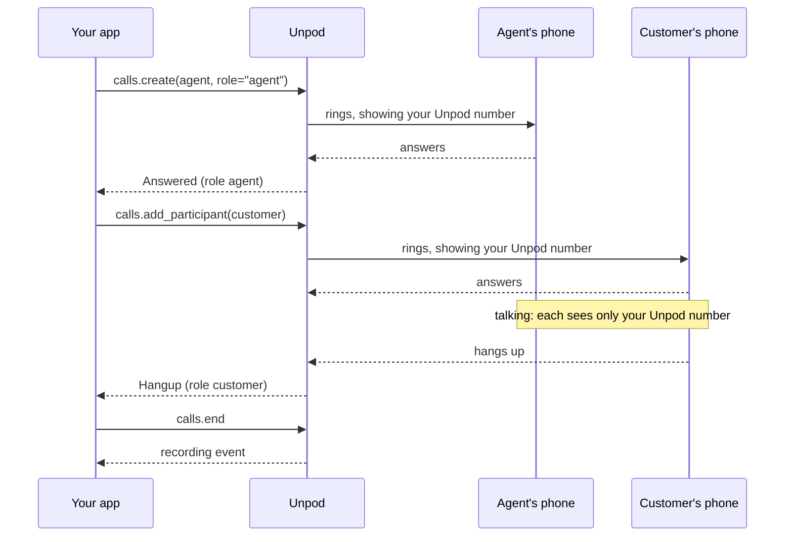

Let two people talk without sharing their phone numbers: a delivery agent and a customer, a
support agent and a caller, a driver and a rider. Unpod dials both from your Unpod number,
so each one sees only that number, never the other's.

A masked call is a call with two participants. If you haven't added a second person to a
call yet, read [Multiple Participants](/telephony/apis/multiple-participants) first. This
page is the production version: everything happens on events, and the call ends as soon as
either person is gone.

## The flow

1. Your backend dials the **agent** with `create`, with `role="agent"`, `record=True`, a
   `status_callback_url`, a `recording_callback_url` and the customer's number in
   `metadata`.
2. When the agent's leg sends `Answered`, your app adds the **customer** with
   `add_participant`, taking the number from `ev.metadata`.
3. When the customer's leg ends, your app ends the call, whether the customer's phone was
   busy (`Busy Line`), rang out (`Ring Timeout Reached`, `No Answer`), rejected the call
   (`Rejected`) or they hung up after talking. Otherwise the agent waits on the line alone.
   When the agent's leg ends, Unpod already hangs up the customer; calling `end` again is
   harmless.
4. On each `Hangup`, your app saves the outcome from `ev.role` and `ev.hangup_cause`.
5. When the recording is ready, your app saves it.



## Start a masked call

Install the SDK and a web server:

```bash
pip install "unpod>=0.6.2" fastapi uvicorn
```

Export your [credentials](/telephony/introduction#credentials) (`UNPOD_BASE_URL`,
`UNPOD_PLATFORM_TOKEN`, `UNPOD_ORG_HANDLE`) and your
[webhook secret](/telephony/apis/quickstart#receive-your-first-call) as
`UNPOD_WEBHOOK_SECRET`. Your server needs a public https URL (ngrok works, as in the Quick
Start). Start `app.py` with:

```python app.py
import os
from contextlib import suppress

from fastapi import FastAPI, HTTPException, Request
from unpod import AsyncClient
from unpod.telephony import TelephonyAPIError, WebhookSignatureError, parse_call_event

FROM = "+919000000001"             # your Unpod number: all either person sees
BASE = "https://abc123.ngrok.app"  # this server's public https URL
SECRET = os.environ["UNPOD_WEBHOOK_SECRET"]
client = AsyncClient()  # one client, reused for every request
app = FastAPI()
# In memory: run one process, or use your database.
ours: set[str] = set()  # call and leg ids seen on signed events
outcomes: dict[str | None, dict[str | None, str | None]] = {}  # call -> role -> cause


async def start_masked_call(agent: str, customer: str) -> str:
    """Dial the agent; /call-status adds the customer once they answer."""
    call = await client.telephony.calls.create(
        FROM, agent, role="agent", record=True,
        status_callback_url=f"{BASE}/call-status",
        recording_callback_url=f"{BASE}/recording",
        metadata={"customer": customer},  # comes back on every event
    )
    return call.call_id
```

`start_masked_call` is a plain function, not a route. Call it from your own backend, for
example when an order is assigned to a delivery agent. A public route that starts calls
would let anyone dial from your number.

The same request over REST:

```bash cURL
curl -s -X POST "https://unpod.ai/api/v2/platform/sbc/v1/calls" \
  -H "Authorization: Token $UNPOD_PLATFORM_TOKEN" -H "Org-Handle: $UNPOD_ORG_HANDLE" \
  -H "Idempotency-Key: $(uuidgen)" -H "Content-Type: application/json" \
  -d '{"from": "+919000000001", "to": "+919000000002", "role": "agent",
       "record": true,
       "status_callback_url": "https://abc123.ngrok.app/call-status",
       "recording_callback_url": "https://abc123.ngrok.app/recording",
       "metadata": {"customer": "+919000000003"}}'
```

Outbound events don't carry the phone numbers in `ev.to` or `ev.from_`, so the customer's
number travels in `metadata`, which Unpod echoes on every event as `ev.metadata`.

<Note>
Whether a call is recorded follows your org's recording policy: `record=True` alone may not
record it. Inbound calls aren't recorded yet. See [Recording](/telephony/apis/recording).
</Note>

{/* TODO(verify): record=true on POST /calls is stored but not read in the SBC source (feat/unpo-284-relay-bridge, recording_completed.rs "Not implemented"); whether a call is recorded follows the org's recording policy */}

## Handle events

Add the two routes below to `app.py`:

```python app.py
@app.post("/call-status")
async def call_status(request: Request):
    try:
        ev = parse_call_event(await request.body(), request.headers, secret=SECRET)
    except WebhookSignatureError:
        raise HTTPException(401)

    ours.update(filter(None, (ev.call_id, ev.leg_id)))  # signed: it's yours
    calls = client.telephony.calls
    customer = ev.metadata.get("customer")
    adding = ev.event == "Answered" and ev.role == "agent" and bool(customer)
    try:
        if adding:
            await calls.add_participant(
                ev.call_id, FROM, customer, role="customer",
                status_callback_url=f"{BASE}/call-status",
                idempotency_key=f"{ev.call_id}:customer",  # a resend never redials
            )
        elif ev.event == "Hangup":
            # an upsert by role: a resent Hangup overwrites, never duplicates
            outcomes.setdefault(ev.call_id, {})[ev.role] = ev.hangup_cause
            await calls.end(ev.call_id)  # never leave the other person alone
    except TelephonyAPIError as e:
        print(ev.call_id, e.status_code, e.message)
        if e.status_code == 429 or e.status_code >= 500:
            raise HTTPException(503)  # transient: Unpod sends the event again
        if adding and e.status_code not in (404, 409):  # 404 gone, 409 dialed
            with suppress(TelephonyAPIError):
                await calls.end(ev.call_id)  # can't dial the customer: free the agent
    return {"ok": True}  # 2xx once signed, or Unpod resends


@app.post("/recording")
async def recording(request: Request):
    # Recording events aren't signed yet: trust only what the API returns
    ev = parse_call_event(await request.body(), request.headers, None, verify=False)
    if ev.call_id not in ours:  # not a call you started, or already saved
        return {"ok": True}
    try:
        rec = await client.telephony.calls.get_recording(ev.call_id)
    except TelephonyAPIError as e:
        if e.status_code not in (403, 404):
            raise HTTPException(503)  # e.g. not ready yet: Unpod sends it again
        return {"ok": True}
    if rec.available:
        ours.discard(ev.call_id)
        print("recording", rec.call_id, rec.duration_secs)  # save with the outcome
    return {"ok": True}


if __name__ == "__main__":
    import uvicorn
    uvicorn.run(app, host="127.0.0.1", port=8000)
```

Run it with `python app.py` and expose it as in the
[Quick Start](/telephony/apis/quickstart#receive-your-first-call). Then start a call from a
second terminal, in the same directory and virtualenv, with all four variables
(`UNPOD_BASE_URL`, `UNPOD_PLATFORM_TOKEN`, `UNPOD_ORG_HANDLE`, `UNPOD_WEBHOOK_SECRET`)
exported, since importing `app` reads them:

```bash
python -c 'import asyncio, app
print(asyncio.run(app.start_masked_call("+919000000002", "+919000000003")))'
```

The agent's phone rings first, showing your Unpod number. When they answer, the customer's
phone rings, also showing your Unpod number, and the two are connected.

Every event for the call has the same `ev.call_id`; `ev.leg_id` tells the two legs apart and
`ev.role` is the `role` you gave each one. Until it gets a 2xx, Unpod resends an event a
few times over about 30 seconds, so every branch is safe to run twice: the
`idempotency_key` stops a resent `Answered` from dialing the customer again, and ending a
call that's already over (`404`) is logged and ignored. A rate limit or server error
answers `503`, so Unpod sends the event again; any other error adding the customer ends
the call, so the agent isn't left waiting. If an `Answered` or `Hangup` is lost for good,
someone can stay on the line: as a backstop, sweep your active calls with `calls.list()`
every few minutes and end any that should be over.

The `/recording` route doesn't check a signature, so it ignores any `call_id` your
`/call-status` route hasn't seen on a signed event (which also skips a resent event once
the recording is saved), then asks the API for the recording with your credentials. You
can also put a secret token in the query string of `recording_callback_url`: Unpod sends
it back unchanged. Save the `call_id` and duration; to download the audio, see
[Recording](/telephony/apis/recording).

{/* TODO(verify): recording events go out unsigned (recording_completed.rs `secret: None`); switch /recording to parse_call_event(..., secret=SECRET) once they are signed */}
{/* TODO(verify): one recording event per leg's session (the customer's carries its own leg id as MPCUUID)? and the REST-originate removal race noted in reporter.rs */}

## Event map

| Event | Leg (`ev.role`) | What your app does |
| --- | --- | --- |
| `Initiated` | `agent`, later `customer` | The leg is being dialed. Optional: save `ev.leg_id` with your record |
| `Ringing` | `agent` | Optional: show "calling the agent" in your app |
| `Ringing` | `customer` | The agent hears the customer's phone ringing. `dial_music` plays nothing yet; to play your own sound, see [ringing sound](/telephony/apis/multiple-participants#play-a-ringing-sound-while-the-second-person-rings) |
| `Answered` | `agent` | Add the customer with `add_participant` |
| `Answered` | `customer` | They're talking. Optional: mark the call connected |
| `Hangup` | `customer` | End the call. `Busy Line`, `Ring Timeout Reached`, `No Answer` or `Rejected`: the customer wasn't reached. `Cancelled`: the agent hung up while the customer's phone was ringing. `Normal Hangup`: they answered |
| `Hangup` | `agent` | Unpod already hangs up the customer; ending the call again is harmless. Any cause but `Normal Hangup` means the agent never answered, so the customer was never dialed |
| `MPCRecordingCompleted` | - | Arrives at `recording_callback_url` after the call. Fetch and save the recording |

Store any other cause (`Service Unavailable`, `Unknown`, ...) and `ev.sip_code` as it is;
see [Hangup causes](/telephony/apis/webhooks#hangup-causes). A call holds at most two
people, so a masked call is always one agent and one customer.

{/* TODO(verify): Webhooks page lists the recording event as RecordingCompleted; the SBC source (recording_completed.rs) sends MPCRecordingCompleted */}

## Customer calls the masked number

The other direction: the customer calls your Unpod number back and you connect them to
their agent. Point the number's answer URL at your app (see
[Incoming Calls](/telephony/apis/incoming-calls#point-your-number-at-your-app)), look up the
agent from the caller's number (`ev.from_` on `StartApp`) in your own data, and reply:

```xml
<Response>
    <Dial><Number>+919000000002</Number></Dial>
</Response>
```

If several pairings share one Unpod number, the caller's number alone can match more than
one agent: give each pairing its own number, or ask the caller for an order ID first. For
the full server, with signature checks and a busy reply, see
[Handle the call](/telephony/apis/incoming-calls#handle-the-call).

<Warning>
Masking an inbound call with `<Dial>` is not verified to hide the caller's number: the
agent may see the customer's real number. Test it with your own phones before relying on
it.
</Warning>

{/* TODO(verify): caller ID the agent sees on an inbound <Dial> (Dial callerId is parsed but not applied; sip_session.rs try_single_target uses dialplan.caller) */}
