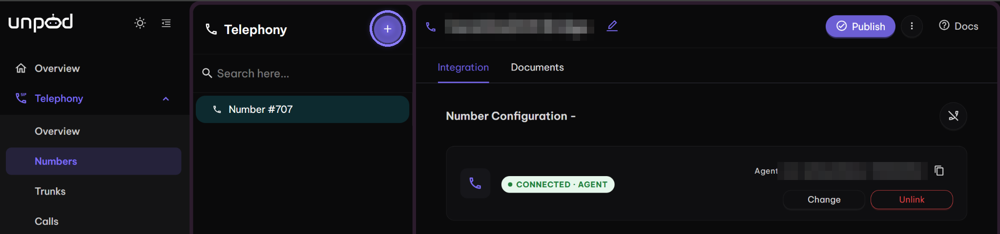
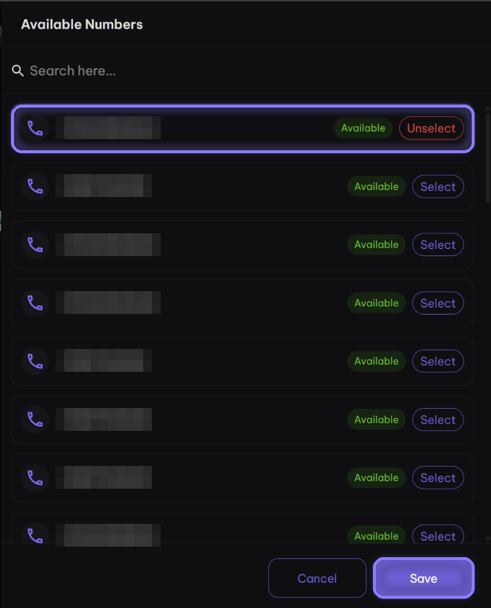
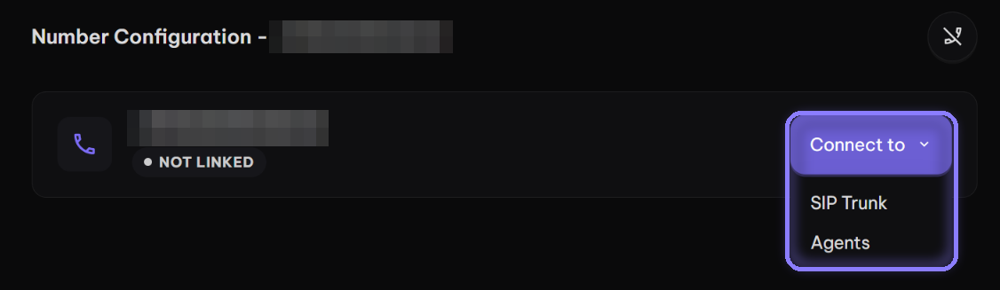
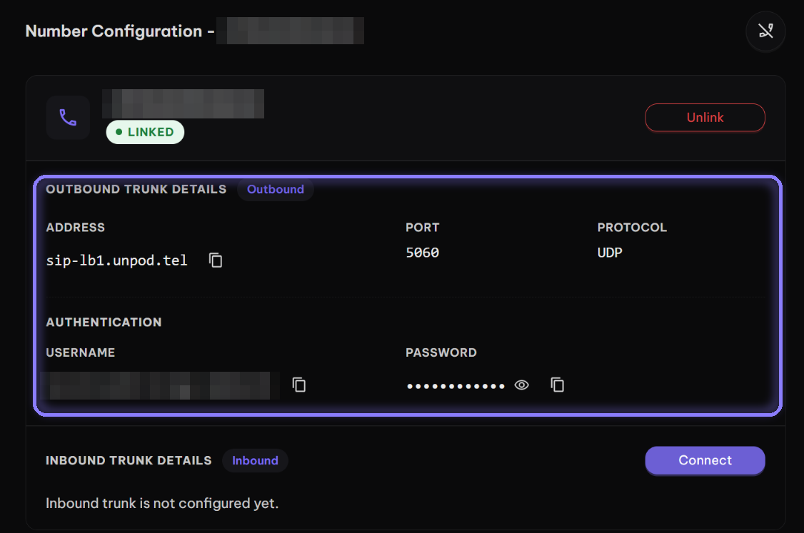

You need an Unpod number to make or receive calls: it's the `from` of the calls you place
and the number people dial to reach you. Add one from the Unpod pool in either of two ways:

- **[From the dashboard](#from-the-dashboard)** - pick a number and connect it in a few
  clicks.
- **[From the API](#from-the-api)** - list the pool, attach a number and check it's ready,
  all in code.

## From the dashboard

<Tip>
Using the Telephony APIs ([Quick Start](/telephony/apis/quickstart))? Attach the number
[from the API](#from-the-api) with `attach_type="human_call"`. The steps below connect it
to a SIP trunk or an agent.
</Tip>

<Steps>
  <Step title="Open Telephony → Numbers and click +">
    The **+** button next to the **Telephony** heading opens the number pool.

    <Frame caption="Telephony → Numbers - the + button opens the number pool">
      
    </Frame>
  </Step>

  <Step title="Select a number and click Save">
    **Available Numbers** lists every number you can add. Click **Select** on one, then
    **Save**.

    <Frame caption="Available Numbers - select one, then Save">
      
    </Frame>
  </Step>

  <Step title="Click Connect to">
    The number starts **Not Linked**. **Connect to** offers **SIP Trunk** (your own SIP
    client places and answers calls) and **Agents** (an Unpod AI agent answers).

    <Frame caption="A new number starts Not Linked - Connect to opens the options">
      
    </Frame>

    {/* TODO(verify): which Connect to option matches attach_type="human_call" (your app controls calls with the Telephony APIs) */}
  </Step>

  <Step title="Ready (SIP Trunk)">
    After **Connect to → SIP Trunk**, the number turns **Linked** and shows its outbound
    trunk details.

    <Frame caption="Outbound Trunk Details - ready as soon as you choose SIP Trunk">
      
    </Frame>
  </Step>
</Steps>

For the trunk values and the inbound setup, see the full
[dashboard walkthrough](/telephony/integrations/unpod/dashboard).

## From the API

Export your [credentials](/telephony/introduction#credentials) (`UNPOD_BASE_URL`,
`UNPOD_PLATFORM_TOKEN`, `UNPOD_ORG_HANDLE`) first.

### List numbers

The list holds the free pool plus the numbers your org already has. Pick one whose
`state` is `NOT_ASSIGNED` and whose `active` is `true`. The SDK folds both into
`status`: `not_assigned` means you can attach it.

<CodeGroup>
```python Python
from unpod import Client

with Client() as client:
    for n in client.telephony.numbers.list():
        print(n.number, n.status)  # not_assigned, assigned or closed
```

```bash cURL
curl -s "https://unpod.ai/api/v2/platform/telephony/numbers/?include_assigned=true" \
  -H "Authorization: Token $UNPOD_PLATFORM_TOKEN" -H "Org-Handle: $UNPOD_ORG_HANDLE"
```
</CodeGroup>

The response:

```json
{"status_code": 200, "message": "...", "data": [
  {"id": 12, "number": "+919000000001", "state": "NOT_ASSIGNED", "active": true},
  {"id": 9, "number": "+919000000002", "state": "ASSIGNED", "active": true}
]}
```

| `status` (SDK) | `state` / `active` (API) | Meaning |
| --- | --- | --- |
| `not_assigned` | `NOT_ASSIGNED` / `true` | Free - you can attach it |
| `assigned` | `ASSIGNED` | Already attached to your org |
| `closed` | anything else | Not available |

### Attach a number

<CodeGroup>
```python Python
from unpod import Client

NUMBER = "+919000000001"  # a not_assigned number from the list

with Client() as client:
    result = client.telephony.numbers.attach(NUMBER, attach_type="human_call")
    for r in result.numbers:  # one row per number
        print(r.number, r.ok, r.connection_state, r.error)
```

```bash cURL
curl -s -X POST "https://unpod.ai/api/v2/platform/telephony/numbers/attach/" \
  -H "Authorization: Token $UNPOD_PLATFORM_TOKEN" -H "Org-Handle: $UNPOD_ORG_HANDLE" \
  -H "Content-Type: application/json" \
  -d '{"numbers": ["+919000000001"], "attach_type": "human_call"}'
```
</CodeGroup>

Pass one number or a list, in strict E.164 (`+` and the country code). Each number
succeeds or fails on its own: check `ok` and `error` on every row (`data.numbers` in the
cURL response).

| Option | Who handles the calls |
| --- | --- |
| `attach_type="human_call"` | Your app, with the Telephony APIs. Leave out `agent_id` |
| `agent_id="…"` | An Unpod AI agent (`attach_type="agent"`, the default) |
| `attach_type="pipeline"`, `pipe_id="…"` | An Unpod pipeline. `pipe_id` is required |

To receive calls on a `human_call` number, point it at your app: see
[Incoming Calls](/telephony/apis/incoming-calls).

### Check status

The overview lists your org's numbers with their `connection_state` (see
[Number states](#number-states)). Check it before you use a number as `from`.

<CodeGroup>
```python Python
from unpod import Client

with Client() as client:
    for o in client.telephony.overview():
        print(o.number, o.connection_state)
```

```bash cURL
curl -s "https://unpod.ai/api/v2/platform/telephony/overview/" \
  -H "Authorization: Token $UNPOD_PLATFORM_TOKEN" -H "Org-Handle: $UNPOD_ORG_HANDLE"
```
</CodeGroup>

### Detach a number

Detach releases the number. It isn't deleted, and you can attach it again later.

<CodeGroup>
```python Python
from unpod import Client

with Client() as client:
    result = client.telephony.numbers.detach("+919000000001")
    for r in result.numbers:
        print(r.number, r.ok, r.error)
```

```bash cURL
curl -s -X POST "https://unpod.ai/api/v2/platform/telephony/numbers/detach/" \
  -H "Authorization: Token $UNPOD_PLATFORM_TOKEN" -H "Org-Handle: $UNPOD_ORG_HANDLE" \
  -H "Content-Type: application/json" \
  -d '{"numbers": ["+919000000001"]}'
```
</CodeGroup>

## Number states

`connection_state` in the overview tells you whether a number is ready:

| `connection_state` | Meaning |
| --- | --- |
| `NOT_LINKED` | Not routed yet. Rejected as the `from` of a call |
| `PENDING_VERIFY` | Accepted as `from` (seen in testing) |
| `LINKED` | Connected |

{/* TODO(verify): which connection_state values can place calls */}

A `403 forbidden: from is not a number available to this organization` on a call means
the `from` number isn't ready: check its `connection_state`.

## Reference

- [List Numbers](/telephony/numbers/list-numbers) - `GET /telephony/numbers/`
- [Telephony Overview](/telephony/calls/overview) - `GET /telephony/overview/`
- [Incoming Calls](/telephony/apis/incoming-calls) - answer calls on your number
