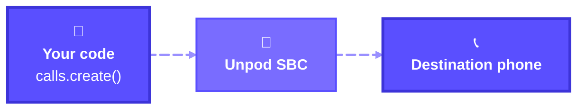
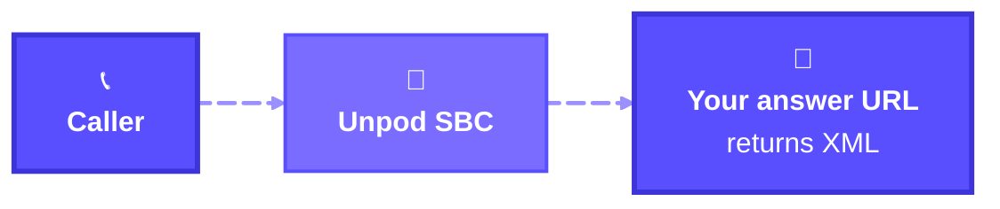

Get started with Unpod Voice in minutes. This guide walks you through setting up a number or
SIP trunk, making your first outbound call, and receiving incoming calls - all from Python.

<Note>
**Preview.** Call control (`client.telephony.calls`) is in preview. Method names follow the
SDK; webhook field and event names follow Plivo, so existing Plivo handlers carry over.
Coming from Plivo? See [Migrate from Plivo](/telephony/apis/migrate-from-plivo).
</Note>

## Prerequisites

1. An Unpod account and organization. Note your **API Token** and **Org-Handle** - see [Authentication](/api/get-started/authentication).
2. The **Call API** switched on for your org. Ask the Unpod team to enable it; until then every call returns `403 call_api_disabled`.
3. A phone number in your org - from the Unpod pool or your own SIP trunk (set up below).
4. Python 3.12+.

## Install the SDK

```bash
pip install "unpod>=0.6.2"
```

To receive calls you also need a small web server:

```bash
pip install fastapi uvicorn
```

## Authenticate

Set three environment variables. The SDK reads them when you create a client with no arguments.

```bash
export UNPOD_BASE_URL=https://unpod.ai
export UNPOD_PLATFORM_TOKEN=<your-api-token>
export UNPOD_ORG_HANDLE=<your-org-handle>
```

<CodeGroup>

```python Async
from unpod import AsyncClient

async with AsyncClient() as client:
    tel = client.telephony
```

```python Sync
from unpod import Client

client = Client()
tel = client.telephony          # same methods, no await
```

```python Explicit auth
from unpod import AsyncClient, TokenAuth

client = AsyncClient(
    base_url="https://unpod.ai/platform",
    auth=TokenAuth("<your-api-token>", org_handle="<your-org-handle>"),
)
```

</CodeGroup>

<Warning>
Always set `UNPOD_BASE_URL` (or pass `base_url`). Without it the SDK falls back to a legacy
host that no longer resolves. Telephony accepts a **Token** or **JWT** with an `Org-Handle` -
never a Bearer API key.
</Warning>

## Set up your number

The caller ID you dial from must be one of your org's numbers. Pick the path that fits you.

<Tabs>
  <Tab title="Unpod number">
    No carrier account needed. Claim a number from the Unpod pool and route it for call control:

    ```python
    numbers = await tel.numbers.list()
    free = next(n.number for n in numbers if n.status == "not_assigned")

    result = await tel.numbers.attach(free, attach_type="human_call")
    for r in result.numbers:
        print(r.number, r.ok, r.connection_state, r.error)
    ```

    `attach_type="human_call"` routes the number without an AI agent - right for call control.
    Use `agent_id="..."` instead to put an Unpod agent on the line.

    This is the SDK version of [Connect an Unpod Number](/telephony/integrations/unpod/dashboard):
    the outbound trunk is ready as soon as the number is attached.
  </Tab>
  <Tab title="Your SIP trunk">
    <Badge color="orange">Beta</Badge> Bring your own carrier. Create a trunk with its SIP
    credentials, then map numbers onto it:

    ```python
    trunk = await tel.trunks.create(
        "My Carrier Trunk",
        "sip:carrier.example.com",
        username="<sip-username>",
        password="<sip-password>",
        transport="tcp",                     # tcp (default), udp or tls
        port="5060",
        source_ips=["203.0.113.10", "198.51.100.0/24"],   # carrier IPs allowed in
    )
    print(trunk.id)                          # e.g. 21

    # number ids come from the overview of your org's numbers
    overview = await tel.overview()
    number_id = next(o.number_id for o in overview if o.number == "+919000000001")

    mapped = await tel.trunks.attach_numbers(trunk.id, [number_id])
    print(mapped.origin_endpoint.ingress)    # point your carrier's inbound traffic here
    print(mapped.origin_endpoint.accepted_source_ips)
    ```

    Full trunk lifecycle: [Numbers & Trunks](/telephony/sip-trunking/trunks).
  </Tab>
</Tabs>

Check the number is connected before you dial:

```python
for o in await tel.overview():
    print(o.number, o.connection_state, o.sync_state)
```

## Make an outbound call

Create a call from your Unpod number to any phone number. Dialing is asynchronous: `create`
returns at once with state `initiated`, and progress arrives as webhooks at your
`status_callback_url`.



<CodeGroup>

```python Python (async)
import asyncio
from unpod import AsyncClient


async def main():
    async with AsyncClient() as client:
        call = await client.telephony.calls.create(
            "+919000000001",                 # from_: your Unpod number
            "+919000000002",                 # to: destination (E.164 or SIP URI)
            ring_timeout=30,
            status_callback_url="https://your-app.example.com/call-status",
        )
        print(call.call_id, call.state)      # e.g. 'c_8f2e…', 'initiated'


asyncio.run(main())
```

```python Python (sync)
from unpod import Client

client = Client()
call = client.telephony.calls.create(
    "+919000000001",                         # from_: your Unpod number
    "+919000000002",                         # to: destination
    ring_timeout=30,
    status_callback_url="https://your-app.example.com/call-status",
)
print(call.call_id, call.state)
```

```bash cURL
curl -s -X POST "https://unpod.ai/api/v2/platform/sbc/v1/calls" \
  -H "Authorization: Token <your-api-token>" \
  -H "Org-Handle: <your-org-handle>" \
  -H "Idempotency-Key: $(uuidgen)" \
  -H "Content-Type: application/json" \
  -d '{
    "from": "+919000000001",
    "to": "+919000000002",
    "ring_timeout": 30,
    "status_callback_url": "https://your-app.example.com/call-status"
  }'
```

</CodeGroup>

To play a message when the call is answered, pass an `answer_url`. Unpod fetches it when
the leg connects and runs the instructions it returns:

```python
call = await client.telephony.calls.create(
    "+919000000001", "+919000000002",
    answer_url="https://your-app.example.com/answer",
    answer_method="POST",
)
```

```xml answer.xml
<Response>
    <Speak>Congratulations! You've made your first outbound call with Unpod!</Speak>
</Response>
```

Store `call.call_id` - every later step (add a participant, play audio, end) takes it.

## Receive an incoming call

When someone calls your number, Unpod posts the call to your **answer URL** and runs the
XML (or JSON) you reply with.



### Get your webhook secret

Every event Unpod sends is signed. Fetch the secret once (org owner or admin) and store it as
`UNPOD_WEBHOOK_SECRET`:

```python
s = await client.telephony.webhook_secret.rotate()
print(s.pushed_to_sbc)                        # must be True
print(s.secret)                               # shown in full only here
```

<Warning>
Each `rotate()` invalidates the previous secret. Store it in your secret manager, never in code.
</Warning>

### Write the answer server

```python app.py
import os
from fastapi import FastAPI, HTTPException, Request, Response
from unpod.telephony import WebhookSignatureError, parse_call_event

SECRET = os.environ["UNPOD_WEBHOOK_SECRET"]
app = FastAPI()


@app.post("/answer")
async def answer(request: Request):
    try:
        ev = parse_call_event(await request.body(), request.headers, secret=SECRET)
    except WebhookSignatureError:
        raise HTTPException(401)

    if ev.event == "StartApp":               # a new inbound call is ringing
        xml = "<Response><Speak>Hello! Thanks for calling.</Speak></Response>"
        return Response(xml, media_type="application/xml")
    return Response(status_code=200)         # Hangup / RecordStop: acknowledge


if __name__ == "__main__":
    import uvicorn
    uvicorn.run(app, host="0.0.0.0", port=8000)
```

Run: `python app.py`

### Expose your server

Unpod only calls public **https** URLs. Use ngrok to expose your local server:

```bash
ngrok http 8000
```

Copy the HTTPS forwarding URL (e.g. `https://abc123.ngrok.app`).

### Configure your number

Point your number at the answer URL:

```python
from unpod.telephony import InboundConfig

await client.telephony.inbound.set_did("+919000000001", InboundConfig(
    answer_url="https://abc123.ngrok.app/answer",
    answer_method="POST",
    status_callback_url="https://abc123.ngrok.app/answer",
))
```

Now call your Unpod number to hear the greeting!

<Info>
Inbound configuration through the SDK is rolling out. If `set_did` returns `405` or `401`,
ask the Unpod team to set the answer URL on your number for now.
</Info>

## Connect two people

Forward a caller to another number by returning a `Dial` from your answer URL:

```xml
<Response>
    <Record/>
    <Dial><Number>+919000000003</Number></Dial>
</Response>
```

Or bridge two people from code: dial the first one, then add the second when the first
answers (the `Answered` event at your `status_callback_url`):

```python
calls = client.telephony.calls

call = await calls.create(
    "+919000000001",                         # your Unpod number
    "+919000000002",                         # first person (agent)
    role="agent",
    status_callback_url="https://abc123.ngrok.app/call-status",
)

# later, in your /call-status handler, when ev.event == "Answered" and ev.role == "agent":
await calls.add_participant(
    ev.call_id,
    "+919000000001",                         # your Unpod number
    "+919000000003",                         # second person (customer)
    role="customer",
    dial_music="none",
    idempotency_key=f"{ev.call_id}:customer",
)
```

A call holds at most **two participants**. Full walkthrough: [Call Control](/telephony/apis/call-control).

## Next steps

<CardGroup cols={2}>
  <Card title="Call Control" icon="sliders-horizontal" href="/telephony/apis/call-control">
    Bridge, play audio, speak, transfer, DTMF and recording.
  </Card>
  <Card title="Incoming Calls" icon="phone-incoming" href="/telephony/apis/incoming-calls">
    Answer URL, XML and JSON verbs, inbound events.
  </Card>
  <Card title="Webhooks" icon="webhook" href="/telephony/apis/webhooks">
    Verify and parse every call and recording event.
  </Card>
  <Card title="Migrate from Plivo" icon="arrow-right-left" href="/telephony/apis/migrate-from-plivo">
    Method-by-method map from Plivo to the Unpod SDK.
  </Card>
</CardGroup>

### Environment variables

| Variable | Used for |
| --- | --- |
| `UNPOD_BASE_URL` | Unpod host - `https://unpod.ai` |
| `UNPOD_PLATFORM_TOKEN` | Your API token |
| `UNPOD_ORG_HANDLE` | Your org handle |
| `UNPOD_WEBHOOK_SECRET` | Your secret from `webhook_secret.rotate()`, read by your own webhook code |

The SDK reads the first three when you create `AsyncClient()` or `Client()` with no arguments.
