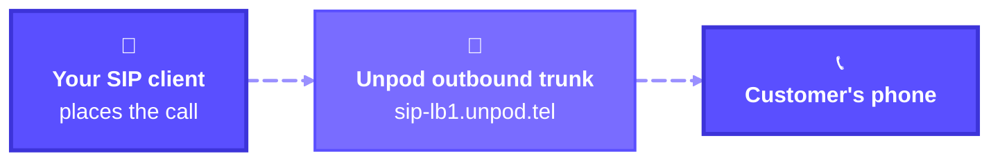
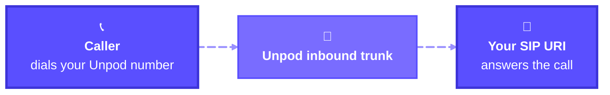

Unpod gives every org a pool of ready-to-use phone numbers. You don't need a carrier
account to use them: pick a number, connect it to a SIP trunk, and you get an
[outbound trunk](#outbound-trunk) for calls you make and an [inbound trunk](#inbound-trunk)
for calls you receive.

## Add a number

<Steps>
  <Step title="Open Telephony → Numbers and click +">
    The **+** button next to the **Telephony** heading opens the number pool. Numbers you
    have already added are listed below it.

    <Frame caption="Telephony → Numbers - the + button opens the number pool">
      
    </Frame>
  </Step>

  <Step title="Select a number and click Save">
    **Available Numbers** lists every number you can claim. Click **Select** on one,
    then **Save**.

    <Frame caption="Available Numbers - select one, then Save">
      
    </Frame>
  </Step>

  <Step title="Click Connect to → SIP Trunk">
    The number now shows **Not Linked**. Click **Connect to** and choose **SIP Trunk**.

    <Frame caption="A new number starts Not Linked - Connect to → SIP Trunk">
      
    </Frame>
  </Step>
</Steps>

## Outbound trunk

<Badge color="green">Created automatically</Badge> - **for calls you make from your Unpod number.**

The moment you choose **Connect to → SIP Trunk**, Unpod creates the outbound trunk and
the number turns **Linked**. Outbound is complete at this point - there is nothing else
to configure.

<Frame caption="Outbound Trunk Details - ready as soon as you choose SIP Trunk">
  
</Frame>

To place calls, point your SIP client at these values:

| Field | Value |
|---|---|
| **Address** | `sip-lb1.unpod.tel` |
| **Port** / **Protocol** | `5060` / `UDP` |
| **Username** | Generated for your number. Use the copy button. |
| **Password** | Generated for your number. Click the eye icon to reveal it, or use the copy button. |

<Warning>
The username and password let anyone place calls on your number. Keep them in a secret
manager, and blur them out before you share a screenshot.
</Warning>

## Inbound trunk

<Badge color="orange">You configure this</Badge> - **for calls people make to your Unpod number.**

Until you add it, the number shows **Inbound trunk is not configured yet** and inbound
calls have nowhere to go.

<Steps>
  <Step title="Click Connect under Inbound Trunk Details">
    <Frame caption="Inbound Trunk Details - Connect opens the trunk form">
      
    </Frame>
  </Step>

  <Step title="Fill in the trunk">
    On the **New trunk** tab, tell Unpod where to send incoming calls:

    | Field | What to enter |
    |---|---|
    | **Name** | A label you'll recognise, e.g. `Support inbound`. |
    | **SIP URI / address** | The SIP host that should answer, e.g. `sip:your-sip-host.example.com`. |
    | **Port** | `5060` unless your SIP host uses another port. |
    | **Transport** | `TCP`, `UDP` or `TLS` - match your SIP host. |
    | **Username** / **Password** | Only if your SIP host requires authentication. Leave blank otherwise. |
    | **Allowed IPs / CIDR** | Optional comma-separated allow-list, e.g. `203.0.113.0/24`. |

    <Frame caption="Configure Trunk - the SIP URI is where Unpod sends incoming calls">
      
    </Frame>

    <Tip>
    Already added an inbound trunk for another number? Open the **Use existing** tab and
    pick it instead of creating a new one.
    </Tip>
  </Step>

  <Step title="Test, then click Create Trunk">
    **Test** checks that Unpod can reach your SIP URI. Then click **Create Trunk**.
    The number now shows **Inbound Trunk Details** with the values you entered. Call the
    number to check it.

    <Frame caption="Inbound trunk configured - Configure edits it, Unlink removes it">
      
    </Frame>
  </Step>
</Steps>

## Troubleshooting

| Direction | Symptom | Check |
|---|---|---|
| Outbound | Calls are rejected | Your SIP client sends to `sip-lb1.unpod.tel:5060` over `UDP` with the exact username and password from **Outbound Trunk Details**. |
| Inbound | Calls never arrive | **SIP URI**, **Port** and **Transport** match your SIP host. Run **Test** from the trunk form. |
| Inbound | Calls stop after you add an allow-list | Your SIP host's IPs are inside **Allowed IPs / CIDR**. Clear the field to test without it. |
| Inbound | Calls should go somewhere else | Click **Configure** under **Inbound Trunk Details** and change the SIP URI. |

## What next

<CardGroup cols={2}>
  <Card title="Bring your own carrier" icon="rocket" href="/telephony/quickstart">
    Already have numbers with a carrier? Connect them over a BYO SIP trunk with the API.
  </Card>
  <Card title="Watch the lifecycle" icon="activity" href="/telephony/calls/overview">
    See each number's connection state, agent link and sync state over the API.
  </Card>
</CardGroup>
