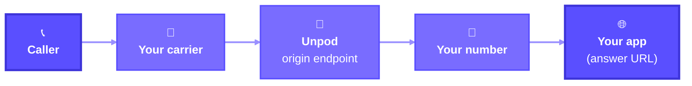

Bring your own carrier: create a trunk with your carrier's SIP details, map one of your
numbers to it, and point the carrier at the Unpod origin endpoint.

<Tip>
Only want to make calls? You don't need a trunk - see the
[Telephony APIs Quick Start](/telephony/apis/quickstart).
</Tip>



{/* TODO(verify): the Unpod agent path for trunk numbers (not documented yet) */}

<Steps>
  <Step title="Credentials">
    Export `UNPOD_BASE_URL`, `UNPOD_PLATFORM_TOKEN` and `UNPOD_ORG_HANDLE` as shown in
    [Credentials](/telephony/introduction#credentials). For Python, install the SDK with
    `pip install "unpod>=0.6.2"` (Python 3.12+).
  </Step>

  <Step title="Create a trunk">
    A trunk holds your carrier's SIP details. `source_ips` are the addresses your carrier
    sends calls from (CIDR ranges allowed).

    <CodeGroup>
    ```python Python
    from unpod import Client

    with Client() as client:
        trunk = client.telephony.trunks.create(
            "my-trunk",
            "sip:carrier.example.com",
            username="<sip-username>",
            password="<sip-password>",
            transport="tcp",           # tcp (default), udp or tls
            port="5060",
            source_ips=["203.0.113.10", "198.51.100.0/24"],
        )
        print(trunk.id)
    ```

    ```bash cURL
    curl -s -X POST "https://unpod.ai/api/v2/platform/telephony/trunks/" \
      -H "Authorization: Token $UNPOD_PLATFORM_TOKEN" -H "Org-Handle: $UNPOD_ORG_HANDLE" \
      -H "Content-Type: application/json" \
      -d '{
        "name": "my-trunk",
        "sip_url": "sip:carrier.example.com",
        "auth_username": "<sip-username>",
        "auth_password": "<sip-password>",
        "transport": "tcp",
        "port": "5060",
        "source_ips": ["203.0.113.10", "198.51.100.0/24"]
      }'
    ```
    </CodeGroup>

    Copy the trunk id (`data.id` in the cURL response) - the next step calls it
    `TRUNK_ID`. See [Create Trunk](/telephony/trunks/create-trunk) for every field.
  </Step>

  <Step title="Map a number to the trunk">
    Mapping takes your number's `id` from the org's number list. Only a `NOT_ASSIGNED`
    number can be mapped; detach an `ASSIGNED` number first
    ([Detach a number](/telephony/apis/numbers#detach-a-number)). Set `TRUNK_ID` to the
    trunk id from step 2. In Python, set `NUMBER` to your number in E.164 and the sample
    finds its id; in cURL, copy the `id` yourself as `NUMBER_ID`.

    The SDK doesn't expose the number id yet, so the Python sample reads the list over HTTP.

    {/* TODO(verify): expose Number.id in the SDK */}
    {/* TODO(verify): how a carrier-owned number first appears in the org's number list */}

    <CodeGroup>
    ```python Python
    import os

    import httpx
    from unpod import Client

    TRUNK_ID = 21            # trunk id from step 2
    NUMBER = "+15551234567"  # your number, E.164

    base = os.environ["UNPOD_BASE_URL"].rstrip("/")
    resp = httpx.get(
        f"{base}/api/v2/platform/telephony/numbers/",
        params={"include_assigned": "true"},
        headers={
            "Authorization": f"Token {os.environ['UNPOD_PLATFORM_TOKEN']}",
            "Org-Handle": os.environ["UNPOD_ORG_HANDLE"],
        },
    )
    resp.raise_for_status()
    number_id = next(
        (n["id"] for n in resp.json()["data"] if n["number"] == NUMBER), None
    )
    if number_id is None:
        raise SystemExit(f"{NUMBER} is not in your org's number list.")

    with Client() as client:
        mapped = client.telephony.trunks.attach_numbers(TRUNK_ID, [number_id])
        print(mapped.origin_endpoint.ingress)
        print(mapped.origin_endpoint.accepted_source_ips)
        for r in mapped.numbers:
            print(r.number, r.ok, r.error)
    ```

    ```bash cURL
    # 1. list your numbers and copy your number's "id"
    curl -s \
      "https://unpod.ai/api/v2/platform/telephony/numbers/?include_assigned=true" \
      -H "Authorization: Token $UNPOD_PLATFORM_TOKEN" -H "Org-Handle: $UNPOD_ORG_HANDLE"

    TRUNK_ID=21   # your trunk id from step 2
    NUMBER_ID=501  # your number's id from the list

    # 2. map it to the trunk
    curl -s -X POST \
      "https://unpod.ai/api/v2/platform/telephony/trunks/$TRUNK_ID/attach-numbers/" \
      -H "Authorization: Token $UNPOD_PLATFORM_TOKEN" -H "Org-Handle: $UNPOD_ORG_HANDLE" \
      -H "Content-Type: application/json" \
      -d "{\"number_ids\": [$NUMBER_ID]}"
    ```
    </CodeGroup>

    If your number isn't in the list, it can't be mapped yet - ask the Unpod team.

    The response has the **origin endpoint**: `ingress` is the host your carrier sends
    calls to (a bare host such as `sip-lb1.unpod.tel`, no `sip:` prefix), and
    `accepted_source_ips` are the addresses Unpod accepts them from. Each eligible number
    gets a row with its own `ok` and `error`, and ineligible ids are left out. If no id is
    an active `NOT_ASSIGNED` number, or none of them maps, the request fails with `400`
    (the SDK raises `httpx.HTTPStatusError` before the loop runs). See
    [Attach Numbers to Trunk](/telephony/trunks/attach-numbers).
  </Step>

  <Step title="Point your carrier at the origin endpoint">
    In your carrier's console, set the number's inbound destination to the `ingress` value.
    Make sure the carrier sends from an address in `accepted_source_ips` - these are the
    `source_ips` you gave the trunk. Your carrier may also ask for the SIP port, the
    transport and the number format to put in the Request-URI; these aren't documented yet.

    {/* TODO(verify): ingress port and transport, and the number format (E.164 with or without +) the Request-URI must carry */}
  </Step>

  <Step title="Verify">
    <CodeGroup>
    ```python Python
    from unpod import Client

    with Client() as client:
        for o in client.telephony.overview():
            print(o.number, o.connection_state, o.termination_kind, o.sync_state)
    ```

    ```bash cURL
    curl -s "https://unpod.ai/api/v2/platform/telephony/overview/" \
      -H "Authorization: Token $UNPOD_PLATFORM_TOKEN" -H "Org-Handle: $UNPOD_ORG_HANDLE"
    ```
    </CodeGroup>

    Right after mapping, your number's `connection_state` reads `PENDING_VERIFY`: it's routed
    and waiting for its first real call. It turns `LINKED` once a real inbound call to it
    connects.
    `NOT_LINKED` means it isn't routed yet and `ERROR` that routing failed (Unpod retries).
    See [Number states](/telephony/apis/numbers#number-states).
  </Step>
</Steps>

Calls to your number now reach Unpod. To answer them in your app, set an answer URL on
each of the trunk's numbers. See
[For a whole SIP trunk](/telephony/apis/incoming-calls#for-a-whole-sip-trunk).

## Next

<CardGroup cols={2}>
  <Card title="Answer calls on this trunk" icon="phone-incoming" href="/telephony/apis/incoming-calls#for-a-whole-sip-trunk">
    Send the trunk's calls to your app with an answer URL per number.
  </Card>
  <Card title="Manage Trunks" icon="git-branch" href="/telephony/sip-trunking/trunks">
    List, inspect and delete your trunks.
  </Card>
  <Card title="Unpod Number → Your SIP" icon="layout-dashboard" href="/telephony/integrations/unpod/dashboard">
    No carrier? Connect a number from the Unpod pool to your SIP endpoint.
  </Card>
  <Card title="Detach numbers" icon="unlink" href="/telephony/trunks/detach-numbers">
    Unmap numbers from the trunk.
  </Card>
</CardGroup>

Detach every number before you [delete the trunk](/telephony/trunks/delete-trunk).
